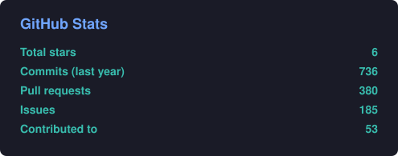
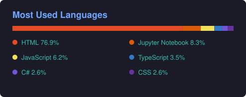

# Hi, I'm Christopher Tineo 👋

---

## 🛠️ Tech Stack

  
  
  
  
  
  
  
  

---

## 👨‍💻 About Me

**Site Reliability Engineer (SRE)** at **[Palantir](https://www.palantir.com)**, focused on Platform Engineering, GitOps, and Kubernetes automation.

- 🛠️ **Currently focused on**: Scaling cloud infrastructure with **Terraform** and **ArgoCD**.
- ☸️ **Community & Leadership**:
  - Organizer at **KCD New York 2026** 🗽
  - Organizer at **Cloud Native SDQ** 🇩🇴
  - Organizer at **Cloud Native New York City** 🏙️
  - Active contributor to the **Kubernetes Contributor Site** ☸️

---

## 🏅 Certifications & Badges

<!-- credly:start -->

<!-- credly:end -->

Updated automatically from [Credly](https://www.credly.com/users/christopher-tineo/badges).

---

## 📈 GitHub Stats

  
  

 

  
  

---

## 🚀 Featured Projects

- **[contributor-site](https://github.com/kubernetes/contributor-site)**: Contributing to the documentation and platform for the global Kubernetes community.
- **[KCD New York](https://github.com/cloudcommunitylabs/kcd-new-york)**: Managing the site and infrastructure for the Kubernetes Community Day NYC.

---

## 📫 Let's Connect

- **LinkedIn**: [in/christopher-tineo](https://www.linkedin.com/in/christopher-tineo/)
- **Twitter**: [@tineo_christ](https://twitter.com/tineo_christ)
- **Email**: [christophertineo02@gmail.com](mailto:christophertineo02@gmail.com)
